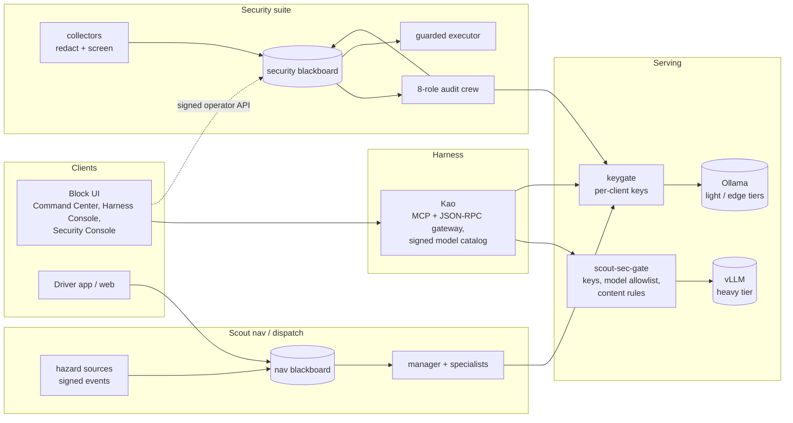

# Imagoro Scout

A local-first agent platform for road-hazard dispatch, built and run on three small machines. It has five parts: an agent **harness** with signed model provenance, a hardened **serving** layer, an LLM-driven **security suite** that watches the lab it runs on, the **Scout nav/dispatch** suite, and a React **block UI** ecosystem that ties them together. The Scout suites run only on open-weight Qwen3 models served in the lab, so nothing they process (events, logs, prompts, answers) leaves the network.

This repository is the public portfolio. It holds working, tested code for the pieces that stand on their own, plus write-ups of the whole system and a running log of updates. See [docs/publishing.md](docs/publishing.md).

## What's in the repo

| Path | What | Runs / tests |
|---|---|---|
| [`packages/gate`](packages/gate) | **scout-sec-gate** (Rust): key auth, per-client model allowlist, per-role content rules, streaming proxy to any OpenAI-compatible engine | `cargo test` (18) |
| [`packages/keygate`](packages/keygate) | **keygate** (Python, stdlib): per-client keys and model scoping in front of Ollama/vLLM; loopback sidecar for single-key harnesses | `python -m unittest` (16) |
| [`packages/security-core`](packages/security-core) | Security suite core: role-scoped blackboard (HMAC tokens, ACLs, Ed25519 operator API), injection screening, redaction, protected-node guard, countermeasure executor | `pytest` (29) |
| [`packages/hazard-sources`](packages/hazard-sources) | Scout nav: NWS / WZDx / 511 / TomTom feeds normalised into signed, citable hazard events; coordinate-free geohash shards | `python -m unittest` (15) |
| [`packages/ui-core`](packages/ui-core) | `@imagoro/core`: block registry, event bus, ACL matrix, broker, intent router, harness gateway client | `vitest` (50) + `tsc` |
| [`models`](models) | Role → model assignments for every suite, and a Modelfile renderer with validation | `python -m unittest` (5) |
| [`docs`](docs) | How each part works and why | |
| [`updates`](updates) | Holistic progress entries ported from the private repos' PRs and commits | |
| [`tools`](tools) | `leakcheck` (runs in CI) and `new_update` (drafts an entry, refuses anything that leaks) | `python -m unittest` (7) |
| [`AGENTS.md`](AGENTS.md) | how updates and package syncs are done, by people or agents | |

Run everything: `./scripts/test-all.sh` (needs Python 3.11+, Rust, Node 20+).

## The system in brief

- **[Harness](docs/harness.md).** Kao exposes the suite's capabilities as native tools over MCP (stdio) and an HTTP JSON-RPC gateway. Every seam validates UTF-8, strips control/bidi/zero-width characters and redacts secrets. Role → model routing lives in the blackboard, and a model may only bind if it's in an **Ed25519-signed catalog** that records lineage, license and digest. Unknown engines or roles fail closed.
- **[Serving](docs/serving.md).** Two stacks share one 16 GB GPU, never at the same time: Ollama for third-party harnesses, vLLM for the project harnesses. Engines only listen on loopback. The network reaches them through gates that check a per-client key and model list, and the Rust gate adds content rules. Smaller GPUs serve the no-think specialists.
- **[Security suite](docs/security-suite.md).** Host collectors redact and screen events before they're posted to a role-scoped blackboard. An eight-role crew of local models (one reasoning manager, seven no-think specialists) turns them into findings and decisions. Countermeasures are proposals: a guard refuses anything aimed at a protected node, an operator approves through a signed console, and the executor is dry-run until a host opts in.
- **[Scout nav / dispatch](docs/nav-suite.md).** Official traffic and weather feeds become signed hazard events that agents must cite by id. Clients ask for coarse geohash cells, never GPS. A manager agent orchestrates narrow specialists into a driver package.
- **[UI ecosystem](docs/ui.md).** [imagoro-ui](https://github.com/scout-hazard-system/imagoro-ui) is a composable block GUI with a node canvas. A substrate-neutral core feeds a React renderer, and it ships as Tauri desktop apps, Flatpak and Android. This repo vendors its zero-dependency core.
- **[Models](docs/models.md).** Qwen3 only (Apache-2.0), with abliterated variants refused. Specialists are thin prompt layers over shared 8B/4B weights, at temperature 0 with reasoning off; only manager roles reason. The heavy tier runs Qwen3-8B-AWQ on vLLM.

## Status

Live in the lab: the security suite (since 2026-10-27), the nav hazard pipeline and blackboard, the Kao gateway, and keygate in front of every engine. The Rust gate is tested but not deployed yet; it replaces keygate in front of vLLM next. See [updates](updates/README.md) for the running log.

## License

Apache-2.0. See [LICENSE](LICENSE) and [NOTICE](NOTICE).
