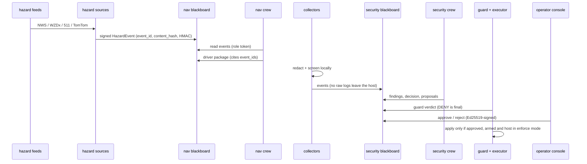

# Architecture

## Machines and tiers

The lab is three machines on a WireGuard mesh. Cross-machine traffic goes over the mesh, inference engines listen only on loopback and are reached through keyed gates, and the security blackboard is mesh-only. (The nav services are still firewall-scoped rather than keyed; that changes with the nav pivot.)

| Role | GPU | Tier | Runs |
|---|---|---|---|
| **Hub** | 4 GB | edge | both blackboards, hazard sources, map/routing backend, the 4B nav specialists, security collector + executor, log export, web edge |
| **Agent box** | 8 GB laptop GPU | light | the Kao harness, the security crew (8 roles on 8B weights), the nav crew runner, collector + executor |
| **Workstation** | 16 GB (RDNA 4) | heavy | vLLM (manager-class models) *or* Ollama for third-party harnesses, the desktop consoles |

A design rule that came out of running it: **heavy models don't go on the 8 GB box.** Its context windows are too small for manager-class work, so managers move to the workstation's vLLM and the agent box keeps the runtimes and the no-think specialists ([updates/2026-10-28-nuc-pivot](../updates/2026-10-28-serving-pivot-and-key-auth.md)).

## Data flow

## Principles

1. **Fail closed.** Unknown role, engine, model, content shape or config → refuse. Gates refuse to start without rules or clients; the harness refuses models that aren't in the signed catalog.
2. **Agents don't act.** Models have no tools in the security crew; runners read and write the blackboard, and only a guarded executor can change a host, and only after a human approves.
3. **Least visibility.** Blackboard tokens are scoped per role to specific categories; dashboards use an `observer` role that never sees raw events. Clients ask for geohash cells, not coordinates.
4. **Treat text as hostile.** Anything that came from a log, a feed or a user is screened before a model reads it and escaped before a human reads it (the vault log export fences it).
5. **Determinism where it matters.** Contract roles run at temperature 0 with reasoning off and answer in fixed formats, so a parser, not a model, decides what happens next.
6. **One lineage.** Qwen3, Apache-2.0, everywhere, so a role behaves the same on any machine that serves it.

## What's private

Kao's source, the deployment (units, network, firewall, provisioning), and the role prompts and eval corpora stay in private repos. This repo describes them; [publishing.md](publishing.md) explains the line.
